# BiliBet-AI 🎯

> **An AI-Native Parimutuel +EV Scanner & Fractional Kelly Execution Engine for Bilibili Prediction Markets (`预测广场` & `赛事中心`)**

[](https://www.python.org/)
[](LICENSE)
[](requirements.txt)
[](SKILL.md)

**BiliBet-AI** is a quantitative research CLI and AI-agent toolkit for discovering positive expected value (**+EV**) mispricings across Bilibili's virtual coin prediction markets.

Unlike legacy tools that only support Bilibili's traditional esports match-winner endpoint (`/x/esports/guess/*`), **BiliBet-AI** is the first open-source engine to fully support Bilibili's site-wide **Prediction Plaza (`/x/act-community/predict/*`)** across all **8 categories** (**Gaming, Sports, Entertainment, Tech, ACG, Lifestyle, General, and Topic Collections**), complete with live time-weighted payout probing and self-dilution-aware Kelly position sizing.

---

## ✨ Why Bilibili Prediction Markets Are a +EV Goldmine

Bilibili's prediction markets do **not** use bookmaker-set fixed odds. Instead, they operate as **time-weighted parimutuel pools (彩池分红制)** funded entirely by retail users betting virtual Bilibili coins (`硬币`).

Because the participant base is heavily driven by **fandom loyalty, memes, wishful thinking, and cognitive biases**, crowd-implied probabilities frequently diverge wildly from objective real-world probabilities ($p_{\text{true}}$):

| Market Category | Real-World Case Study | Crowd Vote Split | Live Effective Odds (`/predict/calc`) | Objective Probability ($p_{\text{true}}$) | Expected Value ($\text{EV}$) | Source of Mispricing |
| :--- | :--- | :--- | :---: | :---: | :---: | :--- |
| **Macro / Lifestyle** (`#197`) | *Will the Federal Reserve hike rates at the December FOMC meeting?* | Yes: `62%`<br>**No: `38%`** | **`2.62x`** (on *No*) | `~95%+` | **`+148%`** | **Cognitive Misreading**: Retail users confused a rate *hike* (`加息`) with a rate *cut* (`降息`) during an easing/pause cycle. |
| **Sports / NBA** (`#142`) | *Will the Portland Trail Blazers (with rookie Yang Hansen) make the West Top 10?* | Yes: `88%`<br>**No: `12%`** | **`8.00x`** (on *No*) | `~80%+` | **`+532%`** | **Home-Player Fan Bias**: Massive patriotic fan voting on a rebuilding lottery team created an 8x payout on the heavy statistical favorite. |
| **Esports / S16** (`#241`) | *Who will earn more MVPs in the Semifinals: Canyon or Wei?* | **Canyon: `25%`**<br>Wei: `59%`<br>Tie: `16%` | **`3.85x`** (on *Canyon*) | `~44%` | **`+69%`** | **Regional Fandom Bias**: Domestic LPL fans piled into IG's jungler (Wei), underpricing GEN's jungler (Canyon) despite GEN being the match favorite. |
| **Tournament Format** (`#219`) | *Will Beijing JDG reach the KPL Grand Finals?* | **Yes: `73%`**<br>No: `27%` | **`1.33x`** (on *Yes*) | `~81.5%` | **`+8.4%`** | **Double-Elimination Neglect**: Priced as a single match despite JDG being in the Winners' Bracket Final with two lives to qualify. |

---

## 🧠 Core Quantitative & Engineering Features

### 1. Full-Category Plaza Penetration (`scene=1` & `scene=2`)
Automatically crawls all 8 top-level categories in Prediction Plaza (`All`, `Gaming`, `Sports`, `Entertainment`, `Tech`, `ACG`, `Lifestyle`, `Other`) and recursively expands nested **Topic Groups (`scene=2`)** so hidden sub-markets (e.g., player props, map counts, award shows) are never missed.

### 2. Official Time-Weight & Self-Dilution Probing (`/predict/calc`)
In Bilibili's Prediction Plaza, final payouts depend on both **stake size** and **entry time weight** (`投入硬币数量 × 预测时间权重`). Relying on raw vote percentages (`percent`) is dangerous:
- **Late-Entry Trap**: Betting on a heavy favorite (`>90%`) late in the cycle can yield an effective payout ratio $< 1.0\text{x}$ (you lose coins even if your prediction is correct!).
- **Small-Pool Self-Dilution**: In niche Tech or Entertainment pools (`3,000–20,000` coins), betting 50 coins significantly dilutes your own payout odds compared to betting 10 coins.

`BiliBet-AI` directly queries Bilibili's live `/x/act-community/predict/calc` estimator across candidate bet sizes $c \in \{1, 2, 5, 10, 15, 20, 30, 50, 80, 100, 150, 200\}$ to measure the exact marginal effective odds:

$$O_{\text{eff}}(c) = \frac{\text{PredictedPayout}(c)}{c}$$

### 3. Parimutuel Odds-Drift Discounting & Late-Sniping Guard (`quant.py`)
Because Prediction Plaza is a **floating parimutuel pool**, the payout returned by `/predict/calc` is only a **static snapshot** assuming zero future bets before market close. Betting days in advance or into tiny pools exposes you to severe **Terminal Odds Drift (终盘赔率漂移)**:
- **Shallow-Pool Smart-Money Dilution**: A niche `3,500`-coin pool showing `4.1x` on an obvious rule misreading can easily compress to `1.3x` once other rational bettors spot it before close.
- **Distant-Market Retail Inflow**: Major tournament finals (`>24h–96h` before close) attract tens of millions of late retail coins on match day, shifting pool ratios dramatically.

`quant.py` automatically parses remaining `hours_to_close` and `pool_coins` to apply an excess-odds retention haircut $\rho \in [0.35, 1.0]$ before optimizing discrete Quarter-Kelly log-wealth utility:

$$O_{\text{term}}(c) = 1 + \rho(\text{Pool}, \Delta t_{\text{close}}) \cdot \left(O_{\text{eff}}(c) - 1\right)$$

$$U(c) = p_{\text{true}} \ln\left(1 + \frac{c \cdot (O_{\text{term}}(c) - 1)}{B / \alpha}\right) + (1 - p_{\text{true}}) \ln\left(1 - \frac{c}{B / \alpha}\right)$$

- Markets with `hours_to_close > 24h` are automatically flagged as **`SNIPE_LATER`**, advising you to wait until the **`3–8h` Late-Sniping Window** (when pool maturity exceeds `90%`) unless overridden via `--ignore-drift`.
- Any option with $O_{\text{eff}}(c) \le 1.00$ is flagged as a **`TRAP`** and blocked.

### 4. Auto-Reconciling SQLite Ledger & Rate-Limit Resilience (`bili_client.py` & `ledger.py`)
- **Resilient Direct HTTPS**: Uses proxy-bypassing direct TLS with exponential retry (`retries=6`) and optional AliDNS DoH + SNI resolution (`use_doh_sni=True`) for Clash/Mihomo TUN environments, plus automatic `-702` rate-limit backoff during batch betting.
- **One-Command Settlement Sync**: Running `python -X utf8 cli.py status` automatically reconciles settled Plaza bets (`/predict/mine/records`) into `data/ledger.db`, tracking `WON` / `LOST` outcomes, official win-rate accuracy, and realized coin PnL.

### 5. Pure-Python Auto-Refreshing QR Login (`auth.py`)
Includes a zero-Pillow pure-Python PNG encoder (`zlib` + `struct`) that generates `login_qr.png` and automatically refreshes it every 140 seconds (before Bilibili's 180s expiration window) until you scan and confirm on the Bilibili mobile app.

---

## 🏗️ System Architecture

```mermaid
flowchart LR
    subgraph Collectors["1. Multi-Source Market Collectors"]
        A1["Prediction Plaza API\n(/x/act-community/predict/*)\n8 Categories + Topic Groups"]
        A2["Live Payout Estimator\n(/x/act-community/predict/calc)\nTime-Weight & Dilution Probe"]
        A3["Esports Match Center API\n(/x/esports/guess/*)"]
    end

    subgraph Brain["2. AI Agent & Quant Engine"]
        B1["AI Agent / Researcher\nWeb Search + Polymarket + Base Rates"]
        B2["+EV Filter & Trap Detector\nEV(c) = p_true * O_eff(c) - 1"]
        B3["Parimutuel Fractional Kelly\nDiscrete Log-Utility Optimizer"]
    end

    subgraph Execution["3. Auth, Execution & Ledger"]
        C1["Auto-Refresh QR Login\n(Pure-Python PNG + Cookie Store)"]
        C2["Rate-Limit Safe Executor\n(Auto -702 Backoff & Retry)"]
        C3["SQLite Local Ledger\n(data/ledger.db ROI Tracking)"]
    end

    Collectors --> Brain --> Execution
```



---

## 🚀 Quick Start

### 1. Installation

```bash
git clone https://github.com/GeorgeZeng997/bilibili-bet-ai.git
cd bilibili-bet-ai
pip install -r requirements.txt
```

### 2. Scan Active Markets Across All Categories (No Login Required)

```bash
# Scan all 8 categories in Prediction Plaza (auto-expanding topic groups) + Esports Match Center
python -X utf8 cli.py scan --category by-tab --include-esports

# Snipe markets closing within the next 24 hours with live 10-coin snapshot odds
python -X utf8 cli.py scan --category by-tab --max-hours 24 --with-odds
```

### 3. Run Drift-Adjusted +EV & Fractional Kelly Position Sizing

Pass your (or your AI agent's) estimated true probabilities (`opt_idx:probability`). `cli.py calc` automatically fetches current pool depth and hours-to-close, discounts static snapshot odds for terminal drift, and blocks premature entries (`SNIPE_LATER`) when `hours_to_close > 24h`:

```bash
python -X utf8 cli.py calc --id 241 --probs "1:0.44,2:0.38,3:0.18" --bankroll 500
```

Example output (inside the `<=24h` sniping window):
```text
====================================================================================
【+EV & 浮动彩池漂移折现精算】 在四强对决中Canyon和Wei谁会拿到更多MVP？ (ID: #241)
本金池: 500.0 币 | 凯利系数: 0.25 | 单笔上限: 100 币 | 当前奖池: 4718000 币 | 距封盘: 8.5h | 狙击窗: <=24h
====================================================================================
选项 1 [Canyon] (大众占比: 25%):
  - AI客观胜率 p_true    : 44.0%
  - 10币静态切片赔率     : 3.85x (静态EV: +69.4%)
  - 终盘漂移折现赔率     : 3.65x (留存率: 93%, 保守EV: +60.6%, Edge: +16.6 pp)
  - 评级                 : 【STRONG】 强力正期望 (折现后EV +60.6%，静态EV +69.4%)
  - 凯利建议当下下注     : 46 枚硬币 (保守预计返还: 167.9 币, 折现赔率: 3.65x, 保守期望净利: +27.88 币)
```

### 4. Authenticate via Mobile QR Code (or Cookie String)

```bash
# Generates login_qr.png (auto-refreshes every 140s) for Bilibili App scanning
python -X utf8 cli.py login

# Or import an existing cookie string directly
python -X utf8 cli.py login --cookie "SESSDATA=xxx; bili_jct=yyy; DedeUserID=zzz"
```

### 5. Place Bets & Track Portfolio Status

```bash
# Place a bet on Prediction Plaza (#197, Option 2, 20 coins) and log to SQLite ledger
python -X utf8 cli.py bet --source plaza --id 197 --opt 2 --coins 20 \
  --title "Fed Dec Rate Hike?" --opt-desc "No" --prob 0.95 --reason "Crowd confused hike with cut"

# Place a bet on Esports Match Center (Note: Bilibili caps traditional esports bets at 10 coins per match)
python -X utf8 cli.py bet --source esports --id 37754 --qid 11858 --detail-id 24320 --coins 10

# Check current coin balance, official 6-month overview, and local SQLite ledger history
python -X utf8 cli.py status
```

---

## 🤖 Using with AI Coding Agents (Claude Code / Antigravity / Cursor)

This repository includes a ready-to-use [`SKILL.md`](SKILL.md) file. When opened inside an agentic IDE:
1. Ask the agent: *"Scan Bilibili Prediction Plaza today, research the real-world probabilities of the most mispriced short-term markets, and build a Quarter-Kelly coin portfolio for my current balance."*
2. The agent will run `cli.py scan`, inspect settlement criteria (`settle_reason` & `settle_text`), search the web for up-to-date statistics/odds, verify live payouts via `cli.py calc`, and execute your approved bets via `cli.py bet`.

---

## 📂 Project Structure

```text
bilibili-bet-ai/
├── auth.py            # Pure-Python PNG QR generator, auto-refresh login poller & cookie parser
├── bili_client.py     # DoH + SNI direct HTTPS client for Prediction Plaza & Esports APIs
├── quant.py           # Parimutuel Fractional Kelly optimizer & /predict/calc dilution prober
├── ledger.py          # SQLite local bet & EV tracking ledger (data/ledger.db)
├── cli.py             # Unified command-line interface (scan, calc, login, bet, status)
├── SKILL.md           # Agentic workflow instructions for AI coding assistants
├── requirements.txt   # Minimal Python dependencies
└── LICENSE            # MIT License
```

---

## 🔒 Security & Disclaimer

1. **Credential Privacy**: Your session cookies (`data/cookies.json`) and local betting history (`data/ledger.db`) are strictly git-ignored via [`.gitignore`](.gitignore). **Never commit or share your `SESSDATA` or `bili_jct` tokens.**
2. **Educational & Research Purpose**: Bilibili coins (`硬币`) are non-redeemable virtual community points used to support content creators and participate in official platform events. This project is provided strictly for educational research into **parimutuel market microstructure, crowd sentiment bias, and Kelly criterion portfolio optimization**.
3. **API Etiquette**: Built-in backoff and sequential request pacing are enforced by default. Do not modify this tool for high-frequency scraping or automated spamming.
